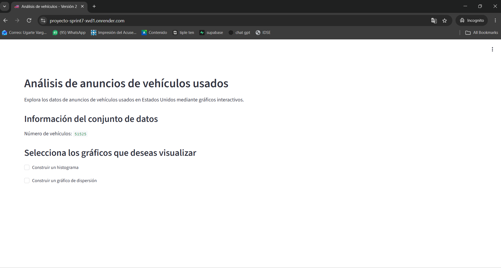
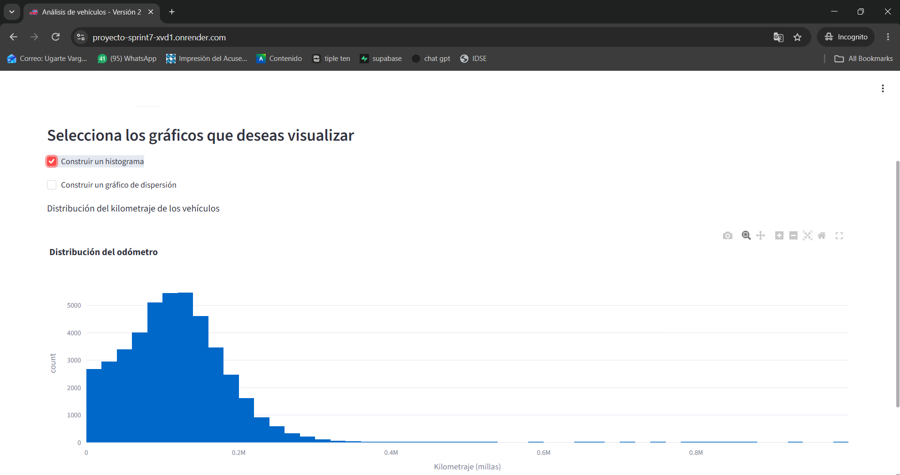
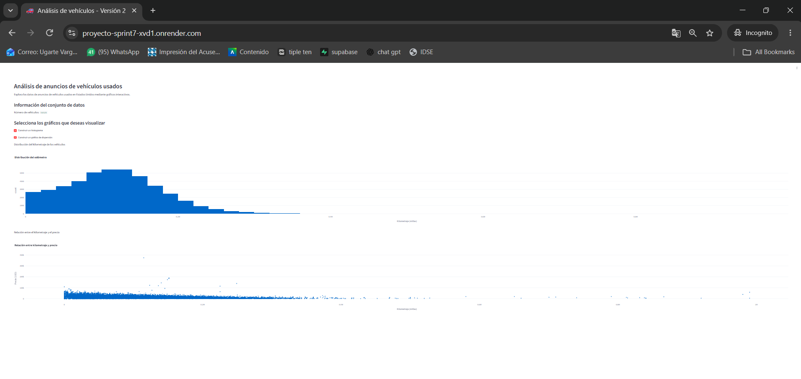

# proyecto_sprint7
proyecto sprint 7 herramientas de desarrollo de software

# Proyecto Sprint 7 — Análisis de vehículos usados

## Descripción del proyecto

Este proyecto consiste en el desarrollo de una aplicación web interactiva para realizar un análisis exploratorio de datos sobre anuncios de vehículos usados en Estados Unidos.

La aplicación permite visualizar información del conjunto de datos `vehicles_us.csv`, utilizando Python, pandas, Plotly y Streamlit.

## Funcionalidades

- **Histograma:** muestra la distribución del kilometraje (`odometer`) de los vehículos publicados.
- **Gráfico de dispersión:** muestra la relación entre el kilometraje (`odometer`) y el precio (`price`) de los vehículos.
- **Casillas de verificación:** permiten activar o desactivar cada gráfico de manera independiente.
- **Información general:** muestra la cantidad de registros contenidos en el conjunto de datos.

## Tecnologías utilizadas

- Python
- pandas
- Plotly
- Streamlit
- Jupyter Notebook
- Git y GitHub
- Render

## Estructura del proyecto

```text
proyecto_sprint7/
├── app.py
├── vehicles_us.csv
├── requirements.txt
├── README.md
├── .gitignore
└── notebooks/
    └── EDA.ipynb
```

## Ejecución local

Instalar las dependencias:

```bash
pip install -r requirements.txt
```

Iniciar la aplicación:

```bash
streamlit run app.py
```

## Aplicación web

**Enlace de Render:** Pendiente de agregar después del despliegue.

## Autor

jvaugarte

## Propósito académico

Proyecto desarrollado como parte del Sprint 7 del programa de Ciencia de Datos de TripleTen.

## Aplicación web desplegada en Render

**Enlace público:** https://proyecto-sprint7-xvd1.onrender.com/

# Asegúrate de que el requirements.txt tenga todas las librerías necesarias para que el despliegue no falle (por ejemplo streamlit, pandas, plotly, etc.).

 PS C:\Users\jvaug\Documents\proyecto_sprint7> Get-Content requirements.txt
altair==6.3.0
anyio==4.15.1
attrs==26.1.0
certifi==2026.10.23
charset-normalizer==3.5.2
click==8.5.0
h11==0.16.0
idna==3.20
itsdangerous==2.2.0
Jinja2==3.1.6
jsonschema==4.26.0
jsonschema-specifications==2025.9.1
MarkupSafe==3.0.4
narwhals==2.27.1
numpy==2.5.4
packaging==26.3
pandas==3.1.0
pillow==13.0.0
plotly==7.1.0
protobuf==7.36.2
pyarrow==26.0.0
pydeck==0.9.3
python-dateutil==3.0.0
python-multipart==0.0.32
referencing==0.37.0
requests==2.34.2
rpds-py==2026.9.1
six==1.17.0
starlette==1.10.0
streamlit==1.66.1
typing_extensions==4.16.0
tzdata==2026.5
urllib3==2.8.0
uvicorn==0.54.0
watchdog==6.0.0
websockets==17.3

## Vista previa del proyecto

### Pantalla principal


### Histograma de kilometraje


### Gráfico de dispersión



